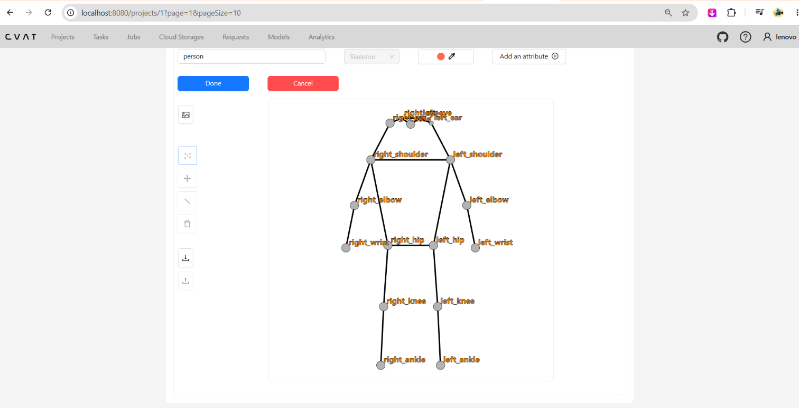
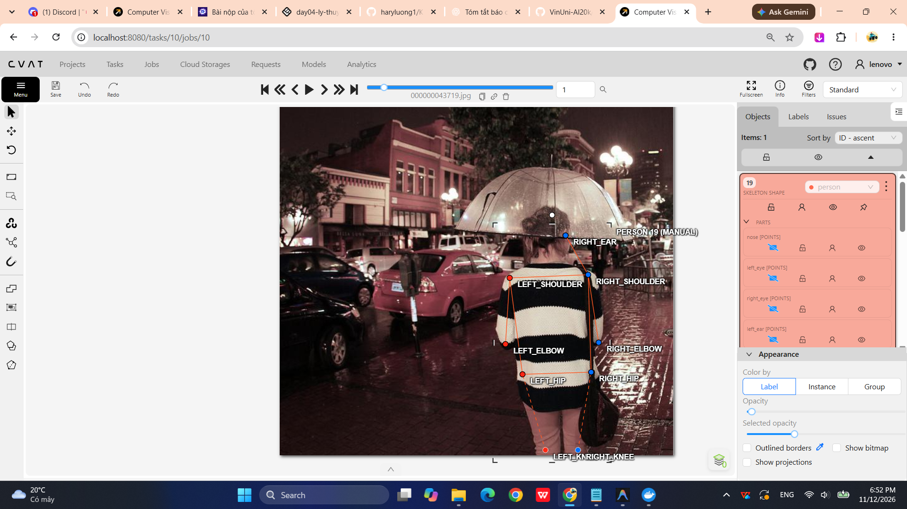
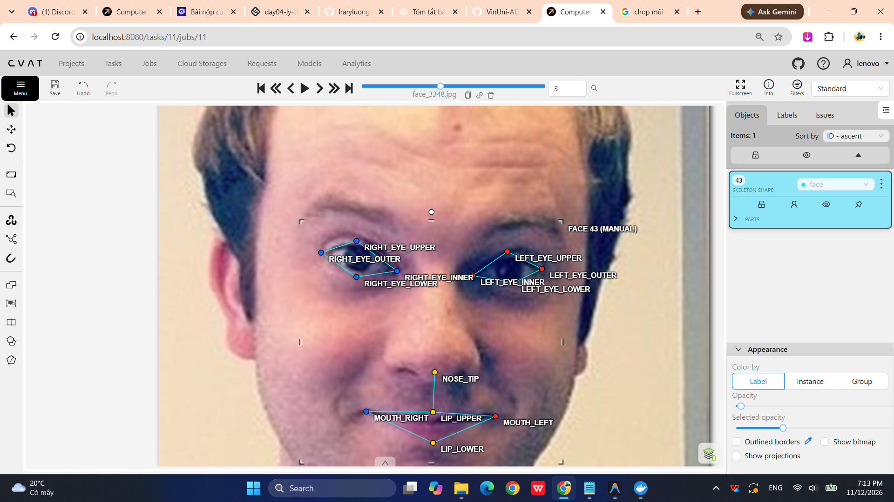
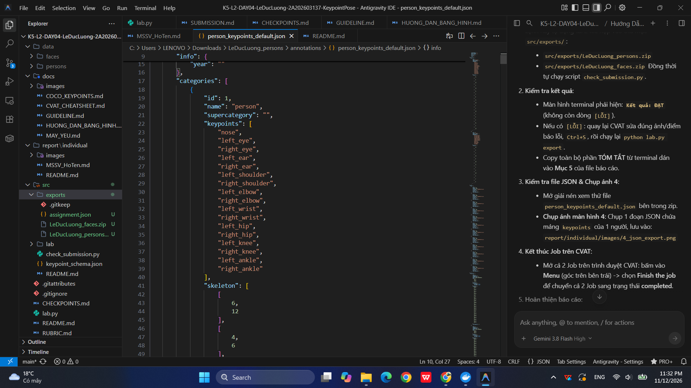

# Báo cáo cá nhân — LeDucLuong-2A202603137

Dữ liệu: 12 ảnh người COCO val2017 (Lin et al., 2014) và 8 ảnh chân dung Wikimedia Commons, chỉ dùng trong lớp.

## 0. Thông tin học viên

- Họ tên: Lê Đức Lương
- MSSV: 2A202603137
- Email: haryluong1@gmail.com
- Link repository: https://github.com/haryluong1/K5-L2-DAY04-LeDucLuong-2A202603137-KeypointPose
- Phiên bản CVAT (Help → About): 2.82
- Máy: hệ điều hành Windows 11 · RAM 16 GB · chạy CVAT chế độ đầy đủ
- Bộ ảnh (`src/exports/assignment.json` do `lab.py setup` tạo): có
- Giờ bắt đầu: 17:00
- Giờ kết thúc: 23:45

## 1. Kiểm tra label (CP0)

| Label | Kiểu | Số điểm | Tên điểm đúng bảng của lab? | Đúng thứ tự? | Số cạnh |
|---|---|---:|---|---|---:|
| `person` | Skeleton | 17 | Đúng | Đúng | 19 |
| `face` | Skeleton | 13 | Đúng | Đúng | 13 |

Mẫu `person` dựng theo người quay mặt về camera (các điểm `left_*` nằm bên phải khung mẫu)? Có

Cách đổi cờ `occluded` / `outside` cho **một điểm** trên phiên bản CVAT này (một câu):

Rê chuột vào điểm đó rồi bấm phím `Q` để đổi thành `occluded` (`v = 1`, vòng rỗng), hoặc bấm phím `O` để đổi thành `outside` (`v = 0`, ẩn điểm), hoặc click chuột phải vào điểm để chọn trạng thái tương ứng trong menu.

## 2. Số lượng đã gán và thời gian (CP1, CP2)

| Nhóm ảnh | Số ảnh | Số skeleton đã gán | Số người dưới 60 px (không gán) | Số poster / gương / màn hình bỏ qua | Thời gian (phút) |
|---|---:|---:|---:|---:|---:|
| `easy` | 5 | 5 | 0 | 0 | 25 |
| `occluded` | 3 | 6 | 0 | 0 | 30 |
| `back` | 2 | 3 | 0 | 0 | 20 |
| `small` | 1 | 3 | 1 | 0 | 15 |
| `crowd` | 1 | 3 | 2 | 0 | 20 |
| `faces` | 8 | 8 | — | 0 | 25 |

- Số ảnh người đã xong ở mốc phút 105: 8 / 10
- Thời gian thực tế (phút): CP1 90 · CP2 25 · CP3 20
- Ảnh tốn thời gian nhất là ảnh nào, vì sao?

Ảnh `000000309169.jpg` (nhóm crowd) và `000000043719.jpg` (nhóm back người cầm ô) là những ảnh tốn thời gian nhất. Với ảnh crowd, nhiều người đứng chồng lấn lên nhau làm che khuất các chi, phải lần theo từng đoạn xương từ hông xuống đùi, gối và cổ chân để không bị nhầm xương người này sang người kia. Với ảnh back cầm ô (`000000043719.jpg`), người quay lưng hoàn toàn nên phải tráo toàn bộ các điểm trái/phải sang phía đối diện trước khi chỉnh khớp, đồng thời phải cân nhắc cờ `v = 1` hay `v = 0` cho các khớp bị cơ thể tự che.

## 3. Bảng ca khó (CP1, CP2)

Mỗi điểm bạn phân vân một dòng, nhất là phân vân giữa `v = 1` và `v = 0`, hoặc không chắc hướng người.

| Ảnh | Người / mặt | Điểm | Cờ đã chọn | Phân vân giữa | Lý do chọn |
|---|---|---|---:|---|---|
| `000000043719.jpg` | Người #1 | `nose`, `left_eye`, `right_eye`, `left_ear` | 0 | `v = 1` và `v = 0` | Người quay lưng, mặt khuất hoàn toàn sau tóc và gáy, ba người ước lượng sẽ đặt tản mát nên chọn `outside`. `right_ear` vẫn thấy viền nên giữ `v = 2`. |
| `000000043719.jpg` | Người #1 | `left_wrist`, `right_wrist` | 0 | `v = 1` và `v = 0` | Hai tay ở trước người (một tay cầm cán ô), bị thân che hoàn toàn. Không thấy cẳng tay nên không biết tay co hay buông, chọn `outside` để không đoán bừa. |
| `000000183176.jpg` | Người #1 (ngồi sau xe máy) | `left_shoulder`, `right_shoulder`, `left_hip`, `right_hip` | 0 | `v = 1` và `v = 0` | Thân người ngồi sau bị người lái xe máy che khuất hoàn toàn, chỉ lộ một phần đầu, cánh tay trái và hai đầu gối nên các khớp thân mình chọn `outside`. |
| `000000183176.jpg` | Người #2 (lái xe máy) | `left_eye`, `right_eye` | 1 | `v = 2` và `v = 1` | Đeo kính râm tối, không thấy mắt nhưng vị trí mắt suy ra chắc chắn từ gọng kính, nên chọn `occluded` (cùng quy tắc kính râm của task mặt). |
| `000000193879.jpg` | Người #2 (vận động viên) | `right_knee` | 1 | `v = 2` và `v = 1` | Bước chéo chân (crossover) khi di chuyển sang phải của mình: chân trái bước chéo phía trước, chân phải duỗi ra sau. Gối phải bị chân trái che một phần nhưng ước lượng chắc chắn theo trục đùi và cẳng chân. |
| `000000193879.jpg` | Người #1 (bạn nhặt bóng) | `left_shoulder`, `left_elbow`, `left_wrist`, `left_knee`, `left_ankle` | 0 | `v = 1` và `v = 0` | Nửa thân trái bị vận động viên che hoàn toàn, không thấy đoạn chi nào để suy ra vị trí, nên chọn `outside`. `left_hip` vẫn suy ra được từ hông phải và mép quần soóc nên để `v = 1`. |
| `000000572411.jpg` | Người #1, #3 (ngồi trong toa tàu) | `left_knee`, `left_ankle` | 0 | `v = 1` và `v = 0` | Người ngồi trong toa, chân trái bị thành toa che hẳn, ảnh nhỏ nên không ước lượng được chắc, chọn `outside`. |
| `face_294580.jpg` | Mặt | 8 điểm mắt | 1 | `v = 2` và `v = 1` | Kính râm tối trên ảnh màu, không thấy mí và khóe mắt, nên đặt 8 điểm theo gọng kính và để `occluded`. |
| `face_490361.jpg` | Mặt | `right_eye_lower` | 2 | `v = 2` và `v = 1` | Mắt liếc nhìn lên phía cây kéo, mép mí dưới vẫn thấy rõ dưới con ngươi nên giữ `v = 2`. |

## 4. Bảng tự review (CP3)

Đi từ ảnh cuối về ảnh đầu. 5 ảnh người (ít nhất 2 ảnh `back` hoặc `crowd`) và 3 ảnh mặt. Ít nhất 8 dòng, kể cả dòng `ok`. Ghi lỗi trước, sửa sau.

Mã lỗi dùng đúng một trong: `lr_swap`, `vis_flag`, `position`, `missing`, `extra`, `ok`.

Số thứ tự người (#1, #2…) theo thứ tự skeleton trong file xuất `LeDucLuong_persons.zip`.

| Ảnh | Người / mặt | Điểm | Mã lỗi | Ghi chú | Đã sửa? |
|---|---|---|---|---|---|
| `000000572411.jpg` | Người #2 | cả skeleton | `ok` | Script cảnh báo các điểm trải cao 24 px. Người ngồi trong toa tàu bị thành tàu che từ ngực trở xuống nên các điểm lộ ra chỉ cao 24 px, nhưng kích thước thật tương đương người #1 và #3 ngồi cạnh (> 60 px); đúng trường hợp "bị cắt khung thì bỏ qua cảnh báo" | Giữ nguyên |
| `000000309169.jpg` | Người #3 | `knee`, `ankle` | `ok` | Script cảnh báo cặp knee/ankle ngược phía. Người đang chạy sải chân sang phải ảnh, chân trước/chân sau bắt chéo theo hướng chạy, không phải `lr_swap`. Hai người rất nhỏ ở mép trái ảnh dưới 60 px, không gán là đúng | Không cần sửa |
| `000000193879.jpg` | Người #2 | `left_ankle`, `right_ankle` | `ok` | Script cảnh báo cặp ankle ngược phía. Vận động viên bước chéo chân (chân trái bước chéo phía trước), nên cổ chân trái nằm bên trái cổ chân phải trên ảnh là đúng tư thế | Không cần sửa |
| `000000183176.jpg` | Người #1 | cả skeleton | `missing` | Người ngồi sau xe máy: thấy tay đặt trên vai người lái, tóc, hai đầu gối hai bên xe; cao hơn 60 px nhưng ban đầu sót chưa gán skeleton | Có: đã gán thêm skeleton (6 điểm thấy/đoán được, phần khuất để `outside`) và xuất lại |
| `000000043719.jpg` | Người #1 | toàn bộ | `ok` | Quay lưng: `left_shoulder` / `left_hip` nằm bên trái ảnh, đúng. Mặt và hai cổ tay `v = 0`, cổ chân ngoài khung `v = 0` | Không cần sửa |
| `face_490361.jpg` | Mặt | `lip_lower` | `position` | Điểm môi dưới bị bỏ quên trên trán, chưa kéo xuống miệng | Có: kéo về giữa mép ngoài môi dưới, file xuất đủ 13 điểm |
| `face_294580.jpg` | Mặt | 8 điểm mắt | `ok` | Kính râm tối: 8 điểm mắt đều `occluded`, đặt theo gọng. Mũi, miệng `v = 2` | Không cần sửa |
| `face_264124.jpg` | Mặt | `right_eye_inner` | `ok` | Mặt hơi nghiêng, khóe trong mắt phải bị sống mũi che một phần nên để `v = 1`, các điểm khác `v = 2` | Không cần sửa |

Tổng hợp số lỗi theo mã:

| `lr_swap` | `vis_flag` | `position` | `missing` | `extra` | `ok` |
|---:|---:|---:|---:|---:|---:|
| 0 | 0 | 1 | 1 | 0 | 6 |

Điểm còn phân vân giữa `v = 1` và `v = 0` (ghi cả hai lựa chọn và lý do chọn):

- `000000193879.jpg` Người #1 (bạn nhặt bóng), `left_hip`: chọn `v = 1` thay vì `v = 0`. Hông trái bị vận động viên che, nhưng hông phải và mép quần soóc vẫn thấy, nên suy ra được vị trí khá chắc.
- `000000043719.jpg` Người #1, hai cổ tay: chọn `v = 0` thay vì `v = 1`. Tay cầm cán ô có thể suy theo cán ô, nhưng cẳng tay hoàn toàn không thấy nên vị trí vẫn tản mát; ưu tiên không đoán bừa.

## 5. Kiểm file xuất và kết quả tự kiểm (CP4)

Tự kiểm tay trong file JSON:

| File | Người / mặt kiểm (ảnh, thứ tự) | Số phần tử `keypoints` | Điểm `outside` ra `v = 0`, `occluded` ra `v = 1`? | `num_keypoints` khớp? |
|---|---|---:|---|---|
| `LeDucLuong_persons.zip` | 000000021235.jpg, người #1 | 51 | Có | Khớp (17) |
| `LeDucLuong_persons.zip` | 000000043719.jpg, người #1 | 51 | Có (các điểm ngoài ảnh ra v=0, che ra v=1) | Khớp (9) |
| `LeDucLuong_faces.zip` | face_10579.jpg, mặt #1 | 39 | Có (thấy rõ ra v=2) | Khớp (13) |

Sau khi xuất, CVAT ghi `occluded` thành `v = 1` và `outside` thành `v = 0`. Tọa độ của điểm `outside` trong file là `0, 0` hay tọa độ cũ? Tọa độ cũ (CVAT 2.x ghi tọa độ cũ kèm v=0, chuẩn COCO gốc ghi 0, 0).

Hai job đã chuyển sang completed trên CVAT? Có

Dán phần **TÓM TẮT** in ra từ `src/check_submission.py`:

```text
- File person: LeDucLuong_persons.zip
  Số ảnh: 12 · số skeleton `person`: 20 · mỗi annotation 51 số
  Skeleton theo ảnh: 000000021235=1, 000000043719=1, 000000103970=1, 000000177338=2, 000000183176=2, 000000193879=2, 000000261732=1, 000000309169=3, 000000314154=1, 000000431988=2, 000000455536=1, 000000572411=3
  Cờ v: v=2 239 (70%) · v=1 41 (12%) · v=0 60 (18%)
  num_keypoints trung bình: 14.0
- File face: LeDucLuong_faces.zip
  Số ảnh: 8 · số skeleton `face`: 8 · mỗi annotation 39 số
  Skeleton theo ảnh: face_10579=1, face_264124=1, face_294580=1, face_3348=1, face_359139=1, face_380754=1, face_442231=1, face_490361=1
  Cờ v: v=2 95 (91%) · v=1 9 (9%) · v=0 0 (0%)
  num_keypoints trung bình: 13.0
- Ghi chú: 60 điểm v = 0 vẫn mang tọa độ cũ (CVAT 2.x xuất như vậy; chuẩn COCO ghi 0, 0). Không phải lỗi: điểm v = 0 bị bỏ qua khi huấn luyện và khi chấm.
- Số [LỖI]: 0 · số [CẢNH BÁO]: 5
Kết quả: ĐẠT (đọc lại từng cảnh báo ở trên)
```

Các `[CẢNH BÁO]` còn giữ nguyên và lý do:

- `000000193879.jpg` #2 (ankle): vận động viên bước chéo chân, chân trái bước chéo phía trước nên cổ chân trái nằm bên trái cổ chân phải. Tư thế thật, giữ nguyên.
- `000000309169.jpg` #3 (knee, ankle): người đang chạy sải chân, chân trước/chân sau bắt chéo theo hướng chạy. Tư thế thật, giữ nguyên.
- `000000455536.jpg` #1 (wrist): người trượt ván cúi người, hai tay chống sát nhau trên thành bowl; thứ tự trái/phải của cổ tay vẫn cùng phía với vai. Giữ nguyên.
- `000000572411.jpg` #1 (wrist): người ngồi trong toa, hai tay đặt chéo trước bụng; đúng tư thế thật, giữ nguyên.
- `000000572411.jpg` #2 (các điểm trải cao 24 px): người ngồi trong toa tàu bị thành tàu che khuất phần thân dưới nên các điểm `v > 0` (đầu, vai) chỉ trải cao 24 px, nhưng chiều cao cơ thể thật tương đương hai người ngồi cạnh (> 60 px). Đúng trường hợp script ghi chú "nếu người cao hơn nhưng bị cắt khung thì bỏ qua cảnh báo này", nên giữ nguyên.

## 6. Ảnh chụp màn hình

1. Label `person` trong label constructor (đủ 17 điểm có tên):

   

2. Một người quay lưng đã gán, cờ đã đặt:

   

3. Một khuôn mặt đã gán 13 điểm, phóng to vùng mắt:

   

4. Một đoạn JSON xuất của một người:

   

Nguồn ảnh: COCO val2017 / Wikimedia Commons.

## 7. Tự đánh giá

1. Lỗi bạn mắc nhiều nhất hôm nay, và cách bạn sẽ tránh ở dự án thật:

   Lỗi hay gặp nhất là bỏ sót: quên kéo một điểm về đúng chỗ (`lip_lower` ở `face_490361` ban đầu còn nằm trên trán) và bỏ sót người bị che nhiều (người ngồi sau xe máy ở `000000183176`). Cả hai lỗi đều đã được phát hiện khi tự review và sửa lại đầy đủ. Ở dự án thật, tôi sẽ: sau mỗi skeleton mở danh sách PARTS đếm đủ điểm; trước khi chuyển ảnh, quét cả ảnh tìm người bị che hoặc ở rìa.

2. Một quy tắc bạn đề xuất thêm vào guideline (kèm ảnh ví dụ nếu có):

   Bổ sung ví dụ cho người bị che gần hết bởi người phía trước (như người ngồi sau xe máy ở `000000183176`): vẫn gán nếu phần cơ thể suy ra được cao từ 60 px, phần khuất để `outside`. Và quy định cách đo 60 px cho người ngồi trong xe hoặc toa tàu bị thành tàu che khuất phần thân dưới.

3. Nhãn của bạn đi vào model ở đâu? Chọn một lỗi bạn đã sửa và nói nó sẽ làm model học sai thế nào (heatmap, trọng số trong loss, hay bước lật ảnh):

   Mỗi điểm `v > 0` thành một đỉnh heatmap Gaussian và có trọng số 1 trong loss. Lỗi `lip_lower` nằm trên trán ở `face_490361` (đã sửa) mang `v = 2`, nên nếu không sửa, heatmap của kênh `lip_lower` sẽ có đỉnh ở trán và model bị phạt khi dự đoán đúng vị trí môi; nó học sai quan hệ hình học mắt–mũi–miệng. Với lỗi `missing` ở `000000183176` (đã bổ sung), nếu bỏ sót thì người ngồi sau bị coi là nền: model học rằng vùng có tay và chân người đó "không có người", làm giảm khả năng phát hiện người bị che.

## 8. Khó khăn và lỗi kỹ thuật

- Thao tác đặt cờ trên từng điểm cần cẩn thận để không bấm nhầm phím tắt (đặc biệt là phím `H` - hidden chỉ ẩn trên màn hình cục bộ mà không lưu cờ lên server).
- Việc tráo các cặp điểm trái/phải cho người quay lưng trên CVAT phải làm thủ công từng cặp điểm do CVAT chưa có nút tự động lật khung skeleton mẫu.

## 9. Tài liệu tham khảo và công cụ AI đã dùng

- Tài liệu hướng dẫn COCO Keypoints Dataset và chuẩn đánh giá OKS (Object Keypoint Similarity).
- CVAT Documentation và các tài liệu guideline trong thư mục `docs/` của bài lab.
- Sử dụng trợ lý AI (Antigravity) để: tra cứu guideline và cách dùng CVAT; giải thích cảnh báo của `check_submission.py`; đối chiếu nhãn trong file xuất với ảnh gốc; soạn nháp mục 3, 4, 7. Tôi đã tự review và chỉnh lại toàn bộ nội dung trước khi nộp.
